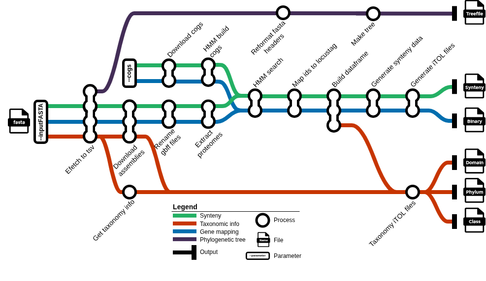

# SynteniToL

[](https://opensource.org/licenses/MIT)
[](https://hub.docker.com/r/manulonigro/syntenitol)

A Nextflow DSL 2 pipeline for synteny analysis of protein sequences against genomic annotations, using HMMER for domain detection and generating visualizations for [iTOL](https://itol.embl.de/) (Interactive Tree of Life).

---

## Table of Contents

- [About](#about)
- [Installation](#installation)
- [Quick Start](#quick-start)
- [Usage](#usage)
- [Pipeline Overview](#pipeline-overview)
- [License](#license)
- [Contact](#contact)

---

## About

SynteniToL enables researchers to perform comparative micro-synteny analysis across multiple prokaryotic genomes by detecting homologous proteins (using COG profiles) and generating publication-ready visualizations for iTOL.



**Key features:**

- Automated retrieval of genome annotations from NCBI
- HMMER-based domain detection using COG (Clusters of Orthologous Groups) profiles
- Synteny context extraction and visualization
- iTOL-compatible output files for interactive phylogenetic trees and synteny plots
- Taxonomy-aware visualizations
- Fully containerized with Docker for reproducible execution

This pipeline is particularly useful for microbiologists studying gene cluster evolution, horizontal gene transfer, and genomic rearrangements across related species.

---

## Installation

### Prerequisites

- [Nextflow](https://www.nextflow.io/) (version 21.0 or higher)
- [Docker](https://www.docker.com/)

---

## Quick Start

**Input FASTA file:**

The input FASTA file should contain protein sequences. Each sequence header should include an accession number that can be resolved by NCBI (e.g., from BLASTp results):

```fasta file
>WP_145111153.1:6-544 formylmethanofuran...
MVLSPADKTNVKAAVKGEG...
>WP_200486823.1:5-533 formylmethanofuran...
MLSGIV...
```

**Run the pipeline** with minimal required parameters:

```bash
nextflow run main.nf \
    --inputFASTA input_proteins.faa \
    --cogs COG1152,COG1795 \
```

**Output:**

```
results/run_timestamp/
├── itol_profiling.txt           # iTOL dataset: Presence/absence profiling
├── itol_synteny_conserved.txt   # iTOL dataset: Synteny of the best conserved GOI
├── itol_synteny_centered_on_fasta_proteins.txt # iTOL dataset: Synteny centered on FASTA proteins
├── itol_taxonomy_class.txt      # iTOL taxonomic info file: Classes
├── itol_taxonomy_domain.txt     # iTOL taxonomic info file: Domains
├── itol_taxonomy_phylum.txt     # iTOL taxonomic info file: Phylums
├── tree_timestamp.nwk           # Phylogenetic tree
├── formatted_headers.fasta      # header format: protein_id|specie_name|strain|isolate
├── genomes_deduplicated.tsv     # Audit of the deduplicated genomes (one row per assembly)
├── run_command.txt             # Reproducibility record
├── timeline.html               # Nextflow execution timeline
├── report.html                 # Nextflow execution report
├── trace.txt                   # Nextflow task trace
└── flowchart.png               # Nextflow workflow DAG
```

---

## Usage

```
Do a blastp in NCBI (https://blast.ncbi.nlm.nih.gov/Blast.cgi?PROGRAM=blastp&PAGE_TYPE=BlastSearch&LINK_LOC=blasthome)
Get the COG id of the query protein

Go to your terminal, move to SynteniToL dir:
nextflow run main.nf [OPTIONS]
```

### Required Parameters

| Parameter          | Description                                                               |
|--------------------|---------------------------------------------------------------------------|
| `--inputFASTA`     | Input FASTA file containing protein sequences (e.g., from BLASTp results) |
| `--cogs`           | Comma-separated list of COG identifiers (e.g., `COG1152,COG1795`). Each COG must appear only once. Not required when using `--only_fasta`. |
**IMPORTANT: the first cog in --cogs is the COG of the protein homologs in the FASTA file**

### Optional Parameters

| Parameter               | Description                                                                                    |
|-------------------------|------------------------------------------------------------------------------------------------|
| `--custom_hmm_profiles` | Comma-separated paths to custom HMM profiles (e.g., `profile_x.hmm,profile_y.hmm`). Each path must appear only once, and each resolved profile name must be unique (names are taken from the filename, without `.hmm` and an optional `profile_` prefix). |
| `--query_profile`       | Profile label used as reference for synteny plots instead of the first COG (must match a COG or custom profile name) |
| `--gene_order`          | Optional comma-separated list defining the column order of `itol_profiling.txt` (e.g., `COG1795,COG1152`). Every gene must exist in `--cogs`/`--custom_hmm_profiles`; genes missing from the list are appended at the end in CLI order and a warning is printed (the run is not stopped). The synteny reference (`--query_profile`) is unaffected. |
| `--color_by_group`      | Group COGs for coloring in iTOL (format: `COG1229-COG1029,COG2218`)                             |
| `--no_taxonomy`         | Skip NCBI taxonomy lookup and taxonomic iTOL layers (domain/phylum/class)                      |
| `--window`              | Genomic context window, in base pairs on **each side** of the reference gene, used for the synteny plots (default: `30000`; minimum: `5000`). |
| `--only_fasta`          | Only generate `formatted_headers.fasta` and the tree; skip the synteny/HMM analysis and taxonomy. `--cogs` is not required with this flag; other analysis parameters (e.g. `--gene_order`, `--color_by_group`) are ignored with a warning. |
| `--outdir`              | Output directory for results                                                                   |
| `--help`                | Display help message                                                                           |

### NCBI API key (optional)

To increase NCBI rate limits, provide your NCBI API key **without passing it on the command line** (doing so would leak it into the execution report, `run_command.txt`, the Nextflow logs and the process scripts). Instead, use one of the two supported methods:

```bash
# Option 1 (recommended): store it as a Nextflow secret
nextflow secrets set NCBI_API_KEY "your_ncbi_api_key"

# Option 2: export it in your shell before launching (forwarded into the containers)
export NCBI_API_KEY="your_ncbi_api_key"
```

- With **Option 1**, the secret is injected into the NCBI-facing processes at runtime and never appears in `.command.sh`, `run_command.txt`, `report.html` or `trace.txt`.
- With **Option 2**, the key is passed into the Docker containers via a pass-through (`docker.runOptions = '-e NCBI_API_KEY'`), so its value is never written into any command line, report or trace file either.

If no key is provided the pipeline still works, just with public NCBI rate limits (a slower sleep is used between taxonomy queries) and a warning is printed at startup.

### Input validation

Before any process runs, the pipeline checks `--cogs` and `--custom_hmm_profiles` for duplicates. If a value is repeated, the run stops immediately with an error that lists the duplicates (including how many times each appears).

- **`--cogs`**: duplicate COG IDs are rejected (e.g. `COG1152,COG1795,COG1152`).
- **`--custom_hmm_profiles`**: duplicate file paths are rejected; duplicate profile names resolved from different paths are also rejected (e.g. `dir1/gene1.hmm` and `dir2/gene1.hmm` both map to profile name `gene1`).
- **`--gene_order`**: duplicates within the list are rejected, and any gene not present in `--cogs`/`--custom_hmm_profiles` is rejected (e.g. `--gene_order COG1152,COG9999`). Genes from `--cogs`/`--custom_hmm_profiles` missing in `--gene_order` only trigger a warning; they are appended at the end of `itol_profiling.txt` in CLI order.

COG identifiers must also match the format `COGXXXX` with `XXXX` from `0001` to `5950`; invalid IDs are rejected at startup.

- **`--window`**: must be an integer number of base pairs `>= 5000`; smaller values (which would produce a context without meaningful neighbors) are rejected at startup.

### Genome deduplication

The input FASTA usually contains several proteins of interest (paralogs) that belong to the **same genome**. The pipeline copies each genome only **once**, no matter how many proteins of interest point to it, so the genome is not extracted, searched and reported N times.

The `genomes_deduplicated.tsv` file in the output directory reports what was merged (one row per assembly):

| Column                    | Description                                                             |
|---------------------------|-------------------------------------------------------------------------|
| `assembly`                | Assembly accession                                                     |
| `organism` / `isolate`    | Organism and isolate of the assembly                                   |
| `status`                  | `copied` or `no_gbff` (assembly downloaded without a `.gbff` file)        |
| `n_proteins_of_interest`  | Proteins of the input FASTA that point to this assembly                |
| `n_copies_avoided`        | Redundant copies of the genome that were not created                   |
| `genome_file`             | File kept in the genomes directory                                     |
| `proteins_merged`         | Proteins of interest merged in that genome                             |
| `copies_skipped`          | File names that were not created                                       |

### Disk space (hard links)

Every `.gbff` is stored **once** in `work/`. The downloaded assembly, the renamed
genome and the merged `genomes_all` directory are **hard links** to the same
inode, so merging the chunks of genomes does not duplicate the bytes:

```bash
# The same genome seen from the three places where it lives
stat -c '%h %n' work/*/*/gbff_assemblies/ncbi_dataset/data/*/*.gbff   # 3 links
```

- If the hard link cannot be created (e.g. the files are on different
  filesystems), the pipeline falls back to a normal copy, so the run always
  completes. The log of every step reports how many hard links and how many
  real copies were made.
- The links only live inside `work/`: the genomes are not published to the
  results directory.
- The `.gbff` files are only read downstream (never modified in place), so
  sharing the same inode is safe.
- `bin/rename_gbff.py --no_hardlink` disables the hard links and always
  copies (useful for debugging).

Runs made **before** this change still store the genomes three times. The
script `proximas_mejoras/deduplicar_work.py` converts the existing copies into
hard links (it only replaces a file with a link to another file with exactly
the same content):

```bash
python3 proximas_mejoras/deduplicar_work.py --dry-run   # sólo informa
sudo python3 proximas_mejoras/deduplicar_work.py --apply   # aplica los enlaces
```

### Examples

**Basic usage:**

```bash
export NCBI_API_KEY="your_ncbi_api_key"   # optional: set via `nextflow secrets set NCBI_API_KEY "..."` instead
nextflow run main.nf \
    -profile docker \
    --inputFASTA proteins.faa \
    --cogs COG1152,COG1795,COG2218
```

**With group coloring (COG1229 and COG1029 share the same color):**

```bash
nextflow run main.nf \
    -profile docker \
    --inputFASTA proteins.faa \
    --cogs COG1152,COG1229,COG1029,COG2218 \
    --color_by_group "COG1229-COG1029,COG2218,COG1152"
```

**With a custom genomic context window (20 kb on each side of the reference gene):**

```bash
nextflow run main.nf \
    -profile docker \
    --inputFASTA proteins.faa \
    --cogs COG1152,COG1795,COG2218 \
    --window 20000
```

**Only formatted headers (+ tree), no synteny/profiling:**

```bash
nextflow run main.nf \
    -profile docker \
    --inputFASTA proteins.faa \
    --only_fasta
```
With `--only_fasta` the pipeline only downloads the referenced genomes, reformats the FASTA headers to `protein_id|specie_name|strain|isolate` and builds the tree. The HMM search, synteny analysis, iTOL files and taxonomy lookup are skipped, so `--cogs`, `--custom_hmm_profiles`, `--gene_order`, `--query_profile` and `--color_by_group` are ignored (a warning is printed if any of them is provided).

### Getting an NCBI API Key

1. Sign in to your [NCBI account](https://www.ncbi.nlm.nih.gov/account/)
2. Go to [API Keys Settings](https://www.ncbi.nlm.nih.gov/account/settings/)
3. Generate a new API key

> **Note:** Without an API key, NCBI limits requests to 3 per second. With an API key, the limit increases to 10 per second.

---

**Pipeline steps in detail:**

1. **NCBI Data Fetching**: Parses input FASTA and retrieves genome metadata from NCBI using E-utilities
2. **Genome Download**: Downloads genome annotations (GBFF) from NCBI Assembly Database
3. **COG Profile Download**: Fetches COG multiple sequence alignments from NCBI
4. **HMM Profile Building**: Builds HMM profiles from COG alignments using `hmmbuild`
5. **Domain Detection**: Scans all proteomes with HMMER using `hmmsearch`
6. **Gene Mapping**: Maps protein IDs to locus tags and gene positions
7. **Synteny Analysis**: Extracts syntenic contexts around the first COG of --cogs
8. **Visualization**: Generates iTOL-compatible files for interactive visualization

> With `--only_fasta` only steps 1-2 run (to build `formatted_headers.fasta`), plus the phylogenetic tree reconstruction (see `modules/make_tree.nf`).

---

## Testing

SynteniToL ships with a test suite in `tests/`:

- **CLI validation tests** (fast): `test_unknown_parameter.sh`,
  `test_duplicate_cogs.sh`, `test_duplicate_custom_profiles.sh`,
  `test_gene_order.sh`. They check that invalid parameters are rejected before
  the pipeline starts.
- **`--only_fasta` integration test** (`test_only_fasta.sh`): runs the real
  pipeline with `--only_fasta` and checks that `formatted_headers.fasta` and the
  tree are produced while no synteny/iTOL files are generated.
- **Regression test** (`test_regression.sh`): re-runs the exact command from the
  stable run `results/run_20260916_142328` (stored in
  `tests/test_result/test_run_command.txt`) against the test FASTA
  `data/fwd/small_fwda_test` and compares the 6 resulting `itol_*.txt` files
  against the golden set in `tests/test_result/`.

### Run all tests

```bash
tests/run_all_tests.sh
```

Expected total duration: **~13-14 min**. About 11 min of that is the regression
re-running the real pipeline (this is normal, not a hang); the CLI validation
tests take ~1-3 min and run without network access.

To skip the regression (CLI validation only, ~1-3 min):

```bash
tests/run_all_tests.sh --skip-regression
```

Valid options for `run_all_tests.sh`:

- `--skip-regression`: skips `test_regression.sh`.
- `-h` / `--help`: show usage and available options.

Any other option (e.g. a typo like `--skip-regresion`) aborts the suite with
exit 2 **before running any test** and lists the available options.

### Regression test only

```bash
tests/test_regression.sh
```

Valid options for `test_regression.sh`:

- `--outdir <path>`: output directory for the new run (default
  `results/regression_<timestamp>`).
- `-h` / `--help`: show usage and available options.

Any unknown option, `--outdir` without a value, or extra arguments abort the
script with exit 2 before launching the pipeline.

The new run is kept in `results/regression_<timestamp>/`. If anything changed:

- A `WARNING` is printed and a detailed diff is written to
  `results/regression_<timestamp>/itol_diff_report.txt`.
- Compare it against the golden set to decide whether the change matches the
  latest implementation.
- If the change is intentional, regenerate the golden set (see
  `tests/test_result/readme.md`).

You can also compare two directories manually, without re-running the pipeline:

```bash
python3 tests/compare_itol_results.py \
    --reference tests/test_result \
    --current results/run_XXXXXX_YYYYYYYY
```

The comparison normalizes row order (Nextflow parallelism does not produce false
changes) and reports header, gene and color differences.

---

## License

This project is licensed under the MIT License - see the [LICENSE](LICENSE) file for details.

---

## Contact

**Author:** ManuLONIGRO
**Email:** lonigromanuel@gmail.com

For questions, issues, or feature requests, please open an issue on the project repository.

